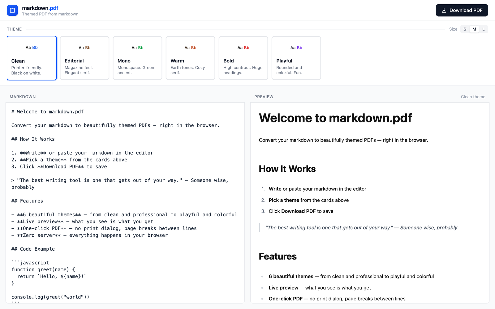

<h1>markdown.pdf</h1>

Paste Markdown, pick a theme, download a PDF. 
Everything runs in your browser, with no server or account.

  
  
  
  

<a href="https://markdown.santiagoalonso.com/">Try it live</a>

markdown.pdf turns a Markdown file into a styled PDF without a print dialog.

- Six themes, from plain Clean to serif Editorial and colorful Playful.
- Pages break between lines and blocks, never mid-line or right after a heading.
- Tables, task lists and highlighted code blocks come through.

## How it works

Type or paste on the left and the preview updates on the right; on a phone, a tab switches between them. Pick a theme and a font size, then download: the file is named after your first heading. Your text, theme and size stay in the browser for your next visit.

## Limits

Each page is saved as an image, so text in the PDF can't be selected or searched and links don't work. Theme fonts load from Google Fonts.

## Install

Use it at [markdown.santiagoalonso.com](https://markdown.santiagoalonso.com/), or run it locally with `npm install` and `npm run dev`. It uses [react-markdown](https://github.com/remarkjs/react-markdown), [html-to-image](https://github.com/bubkoo/html-to-image) and [jsPDF](https://github.com/parallax/jsPDF).

---

[MIT](LICENSE)

Made by [santiagoalonso.com](https://santiagoalonso.com)
